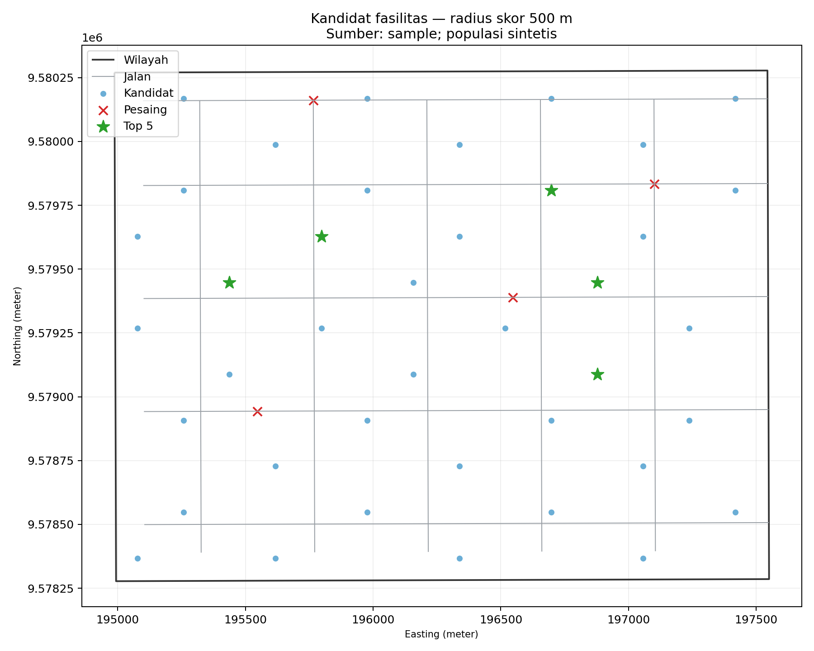

# Analisis Spasial Penentuan Lokasi Fasilitas

Repositori **`analisis-lokasi-fasilitas-gis`** adalah studi kasus GIS yang membandingkan kandidat lokasi fasilitas menggunakan populasi, akses jaringan jalan, dan jarak terhadap pesaing. Analisis dirancang agar dapat dicoba pada laptop dengan perangkat lunak sumber terbuka.

> **Penting:** angka dan peta yang disertakan adalah hasil ilustrasi dari fixture lokal dan populasi sintetis, bukan rekomendasi bisnis. Pengambilan data OpenStreetMap (OSM) tersedia, tetapi pada saat implementasi layanan OSM tidak dapat diakses dari lingkungan eksekusi. Jangan menganggap fixture sebagai data lapangan.

## Latar belakang

Materi kuliah praktisi **“Career and Competition in Industrial Era with GIS”** oleh Widi Primadepa (GIS analyst, alumni Informatika Universitas Bengkulu) membahas peluang lulusan Informatika menjadi pengembang GIS, penerapan GIS lintas sektor—termasuk lokasi gerai ritel dan efisiensi logistik—serta alternatif sumber terbuka seperti QGIS, PostGIS, dan GeoPandas. Materi juga menyoroti data antarinstansi yang tersekat, pentingnya memahami alur kerja/kebutuhan, dan AI sebagai pembantu yang dibatasi pemahaman pengguna.

Implementasi ini adalah **usulan studi kasus**, bukan klaim bahwa materi memberikan model skor atau angka hasil tertentu. Proyek memperlihatkan alur kerja data spasial terbuka yang bisa dipahami, diperiksa, dan dijalankan ulang.

## Wilayah, data, dan status data

Wilayah contoh bawaan adalah **kawasan pusat Kota Bengkulu (area ilustrasi)** dengan bounding box WGS84 di `config.yaml`; ini bukan batas kecamatan atau administrasi resmi. Nama area, bounding box, radius, bobot, dan jumlah kandidat dapat diganti melalui konfigurasi. Bounding box dipakai saat memilih sumber OSM; untuk lokasi lain dalam mode offline, ganti juga fixture GeoJSON di `data/sample/` agar jaringan dan pesaingnya sesuai dengan area baru.

- **Jalan dan pesaing dari OSM:** opsi `--source osm` mengambil jaringan jalan `drive` dan POI dengan tag toko yang ditentukan di config. Jika memakai hasil OSM, atribusikan **© OpenStreetMap contributors** dan perhatikan lisensi ODbL. Cakupan/kelengkapan OSM berbeda menurut tempat.
- **Fixture sample:** `data/sample/study_area.geojson`, `roads.geojson`, dan `competitors.geojson` adalah geometri kecil buatan untuk menjalankan contoh tanpa internet. Fixture tersebut **bukan data OpenStreetMap** dan bukan survei.
- **Populasi:** tidak memakai angka resmi. Program membangkitkan grid populasi **sintetis** dengan seed tetap; nilai dibuat berkorelasi dengan kedekatan ke jalan dan variasi acak kecil. Nilai tersebut hanya untuk demonstrasi perhitungan.
- **Kandidat:** grid titik dibuat di dalam wilayah, disaring menurut jarak maksimum ke jalan, lalu dianalisis.

Saat tugas ini dijalankan, permintaan ke layanan OSM gagal (Overpass mengembalikan HTTP 403 atau timeout). Karena itu, **hasil aktual di bawah memakai fixture sample**. Kode OSM ditulis terhadap API OSMnx yang terpasang, tetapi unduhan langsung OSM belum diuji end-to-end pada jaringan ini. `auto` akan menampilkan warning dan menggunakan fixture bila unduhan gagal; `osm` akan melaporkan kegagalan tanpa fallback.

## Alur kerja

```text
config.yaml + (OSM / fixture lokal)
              |
       perbaiki geometri
              |
  proyeksikan ke UTM (meter)
              |
 grid populasi sintetis + grid kandidat
              |
 buffer garis lurus + Dijkstra jaringan + metrik pesaing
              |
 min-max 3 kriteria + bobot dari konfigurasi
              |
 ranking + uji sensitivitas radius/bobot
              |
 GeoPackage + CSV + PNG + peta Folium
```

## Metode

1. Semua layer harus memiliki CRS; geometri kosong dibuang dan geometri tidak valid diperbaiki. Layer kemudian diproyeksikan ke CRS UTM yang diperkirakan dari wilayah sebelum jarak dihitung.
2. Untuk setiap radius di `service_radii_m` (default 500 m dan 1.000 m), populasi dalam buffer lurus dihitung.
3. Graf jalan tak berarah dibuat dari garis jalan yang diproyeksikan dan dinodakan pada perpotongan. NetworkX Dijkstra menghitung populasi grid yang dapat dicapai dengan jarak jaringan dalam radius. Jarak connector titik ke simpul jalan terdekat ikut diperhitungkan. Ini analisis jarak, bukan waktu tempuh.
4. Untuk setiap kandidat dihitung jarak ke pesaing terdekat dan jumlah pesaing dalam setiap radius.
5. Nilai populasi buffer, populasi jaringan, dan jarak pesaing dinormalisasi dengan min-max ke 0–1. Jika satu kriteria konstan, nilainya netral 0,5. Skor adalah jumlah nilai normalisasi dikali bobot. Bobot harus nonnegatif dan berjumlah 1.
6. Sensitivitas membandingkan top 5 pada tiap radius dengan tiga skenario bobot alternatif. CSV menyertakan ranking kandidat, overlap top 5, dan apakah urutannya sama dengan baseline.

Bobot awal: populasi 0,45; aksesibilitas jaringan 0,35; jarak pesaing 0,20. Pilihan metrik dan bobot ini merupakan **keputusan implementasi untuk demonstrasi**, bukan bobot yang ditentukan materi kuliah.

## Instalasi dan menjalankan

Python 3.10 atau lebih baru direkomendasikan. Dari direktori repositori:

```powershell
python -m venv .venv
.\.venv\Scripts\Activate.ps1
python -m pip install -r requirements.txt
python -m unittest discover -s tests -v
python -m src.main --source sample
```

Versi yang digunakan untuk uji pada lingkungan ini: Python 3.11.9, GeoPandas 1.2.0, Shapely 2.2.0, pandas 2.3.2, NumPy 2.1.3, Matplotlib 3.10.6, OSMnx 2.1.1, NetworkX 3.6.1, Folium 0.20.0, dan PyYAML 6.0.3. Versi lain yang memenuhi batas di `requirements.txt` belum tentu menghasilkan waktu atau perilaku yang persis sama.

Untuk Linux/macOS, aktifkan dengan `source .venv/bin/activate`. Jalankan `python -m src.main` untuk sumber `auto` atau `python -m src.main --source osm` untuk mewajibkan unduhan OSM. Parameter lain:

```powershell
python -m src.main --config config.yaml --source sample --output-dir outputs
```

Di lingkungan pengembangan ini, pipeline sample selesai sekitar **5,1 detik**; waktu bergantung perangkat. Unduhan OSM bergantung koneksi, layanan, serta batas penggunaan OSMnx/Overpass dan bisa lebih lama atau gagal.

## Hasil aktual dari fixture sample

Hasil berikut berasal dari menjalankan `python -m src.main --source sample` pada konfigurasi bawaan. Ada **40 kandidat** dan **108 sel populasi sintetis**, memakai EPSG:32748. Populasi buffer dan jaringan adalah hitungan ilustratif, bukan jumlah penduduk resmi. Kolom jarak pesaing dibulatkan ke meter.

| Peringkat | Kandidat | Skor 0–1 | Populasi buffer 500 m | Populasi jaringan 500 m | Pesaing terdekat (m) |
|---:|---|---:|---:|---:|---:|
| 1 | K023 | 0,758810 | 10.762 | 4.042 | 516 |
| 2 | K027 | 0,681091 | 11.361 | 2.702 | 535 |
| 3 | K032 | 0,677651 | 10.340 | 3.636 | 404 |
| 4 | K025 | 0,674687 | 11.763 | 2.773 | 336 |
| 5 | K018 | 0,673989 | 11.560 | 2.668 | 448 |



[Peta interaktif HTML](outputs/peta_interaktif.html) tidak memuat tile basemap eksternal, sehingga titik dan garis hasil tetap dapat dilihat offline; basemap web eksternal tidak disertakan.

## Analisis sensitivitas aktual

Pada bobot dasar, kandidat top 5 radius 500 m adalah **K023, K027, K032, K025, K018**. Pada radius 1.000 m, top 5 menjadi **K020, K024, K017, K021, K013**—tidak ada kandidat yang sama pada kedua daftar top 5 tersebut.

| Radius | Skenario bobot | Kandidat yang tetap di top 5 (dari 5) | Urutan sama dengan baseline? |
|---:|---|---:|---|
| 500 m | Lebih beratkan populasi | 4 | Tidak |
| 500 m | Lebih beratkan akses | 2 | Tidak |
| 500 m | Lebih beratkan pesaing | 1 | Tidak |
| 1.000 m | Lebih beratkan populasi | 4 | Tidak |
| 1.000 m | Lebih beratkan akses | 4 | Tidak |
| 1.000 m | Lebih beratkan pesaing | 3 | Tidak |

Ini menunjukkan perubahan bobot maupun radius dapat mengubah urutan prioritas, khususnya pada fixture kecil ini. Stabilitas tersebut hanya hasil demonstrasi pada data sintetis dan tidak bisa digeneralisasi sebagai temuan bisnis.

## Keluaran dan membuka di QGIS

Program membuat:

- `outputs/hasil.gpkg`: GeoPackage dengan layer `study_area`, `roads`, `competitors`, `population_synthetic`, dan `candidates` (termasuk metrik, skor, dan peringkat).
- `outputs/peringkat_kandidat.csv`: metrik serta urutan seluruh kandidat pada radius skor.
- `outputs/analisis_sensitivitas.csv`: urutan kandidat untuk tiap radius dan skenario bobot.
- `outputs/peta_statis.png` dan `outputs/peta_interaktif.html`.

Di QGIS, buka panel **Browser**, buka berkas `outputs/hasil.gpkg`, lalu tambahkan layer yang diperlukan (misalnya `candidates`, `roads`, `competitors`, dan `population_synthetic`). CRS layer GeoPackage sudah terproyeksi dalam meter. Simbolkan `candidates` berdasarkan `rank` atau `score`; tabel CSV juga dapat dibuka sebagai teks ber-delimiter.

## Struktur proyek

```text
README.md
requirements.txt
.gitignore
config.yaml
data/sample/{README.md,study_area.geojson,roads.geojson,competitors.geojson}
src/{data_loader.py,analysis.py,visualize.py,main.py}
tests/test_analysis.py
outputs/{hasil.gpkg,peringkat_kandidat.csv,analisis_sensitivitas.csv,
         peta_statis.png,peta_interaktif.html}
```

## Keterbatasan

- Populasi sintetis bukan sensus, bukan estimasi resmi, dan dipengaruhi asumsi pembangkitan serta seed.
- Fixture jalan dan pesaing dibuat untuk demo; OSM di tempat lain dapat tidak lengkap, salah posisi, atau berbeda definisi/tag.
- Graf aksesibilitas dibuat tak berarah dengan bobot panjang meter; arah jalan satu arah, kecepatan, kemacetan, penyeberangan, hambatan fisik, dan waktu tempuh tidak dimodelkan.
- Analisis tidak memodelkan harga sewa/lahan, kapasitas fasilitas, strategi pesaing, perilaku konsumen, batas administratif, atau validasi lapangan.
- Skor dan bobot bersifat ilustratif. Hasil top 5 bukan rekomendasi bisnis dan perlu ditinjau dengan pemangku kepentingan serta data lokal yang sesuai.
- Koneksi OSM gagal di lingkungan implementasi ini; jalur unduh OSM belum diuji end-to-end. Fixture sample adalah jalur yang benar-benar diuji.

## Catatan tentang file kode

- `src/data_loader.py`: baca YAML, fixture sample, atau OSM; fallback sample mengeluarkan warning yang menjelaskan kegagalan.
- `src/analysis.py`: perbaikan geometri, estimasi UTM, grid, graf NetworkX, metrik, skor, dan sensitivitas.
- `src/visualize.py`: ekspor peta statis Matplotlib dan peta interaktif Folium.
- `src/main.py`: CLI dan penulisan GeoPackage/CSV.
- `tests/test_analysis.py`: uji CRS, geometri, bobot, skor, jaringan, dan fallback offline.

## Mengunggah ke GitHub

Buat repositori publik atau privat bernama `analisis-lokasi-fasilitas-gis`, lalu dari folder proyek:

```powershell
git init
git add README.md requirements.txt .gitignore config.yaml data src tests outputs
git commit -m "Tambahkan analisis GIS lokasi fasilitas"
git branch -M main
git remote add origin https://github.com/USERNAME/analisis-lokasi-fasilitas-gis.git
git push -u origin main
```

Ganti `USERNAME` dengan akun GitHub. Jika remote `origin` sudah disetel, gunakan `git remote set-url origin ...`.


